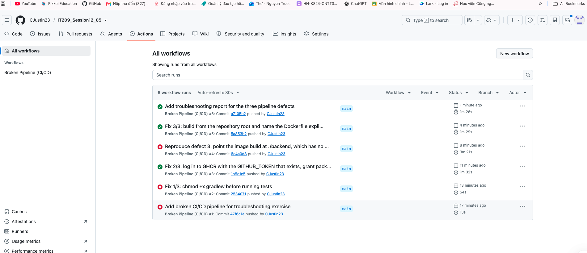

# Bài 5 — Chẩn đoán & khắc phục 3 sự cố đứt gãy Pipeline CI/CD

Sinh viên: **Nguyễn Trường An** — lớp HN-KS24-CNTT3
Repo: https://github.com/CJustin23/IT209_Session12_05
Pipeline: `.github/workflows/broken-pipeline.yml` (job `build-and-release`: test → build → push image lên GHCR)

Mỗi lỗi được sửa và đẩy riêng một commit để log chạy thật trên GitHub Actions chứng minh đúng lỗi đó, không suy đoán.

---

## Lỗi 1 — Permission Denied (Gradle Wrapper thiếu quyền thực thi)

| | |
|---|---|
| Run | [#1](https://github.com/CJustin23/IT209_Session12_05/actions/runs/38461385975) — commit `47f6c1e`, Failure 13s |
| Step fail | `Run unit tests` |
| Log / annotation | `Process completed with exit code 126.` |

**Nguyên nhân.** File `gradlew` được commit mà không có bit thực thi (`git ls-files -s gradlew` trả `100644`). Trên Runner, repo được checkout đúng nguyên mode đó, nên `./gradlew test` không phải là lệnh thực thi được. Exit code **126** của shell có nghĩa "found but not executable" — khác với 127 ("command not found"), nên đây chính xác là vấn đề quyền file chứ không phải thiếu Gradle.

**Cách sửa.** Cấp quyền thực thi trước khi chạy test (commit `2534071`):

```yaml
- name: Grant execute permission for Gradle Wrapper
  run: chmod +x gradlew

- name: Run unit tests
  run: ./gradlew test
```

**Kết quả.** Run [#2](https://github.com/CJustin23/IT209_Session12_05/actions/runs/38461807554): step `Run unit tests` chuyển xanh, JUnit chạy đủ 2 test, pipeline đi tiếp tới bước đăng nhập registry.

---

## Lỗi 2 — Authentication Failed (sai tên biến Secret khi login Docker Registry)

| | |
|---|---|
| Run | [#2](https://github.com/CJustin23/IT209_Session12_05/actions/runs/38461807554) — commit `2534071`, Failure 54s |
| Step fail | `Log in to GitHub Container Registry` (`docker/login-action@v3`) |
| Log / annotation | `Password required` |

**Nguyên nhân.** Bước login khai báo `password: ${{ secrets.REGISTRY_TOKEN }}`, nhưng repo **không có secret tên `REGISTRY_TOKEN`** (Settings → Secrets and variables → Actions để trống). GitHub Actions thay secret không tồn tại bằng chuỗi rỗng, `docker login` nhận mật khẩu rỗng nên báo `Password required`. Lỗi kiểu này rất dễ bị nhầm sang "sai mật khẩu": thực chất biến secret không sai tên thì không bao giờ có giá trị.

**Cách sửa** (commit `1b5e1c5`). Dùng đúng credential có sẵn trong mọi workflow — `GITHUB_TOKEN` — và khai báo quyền needed cho registry, vì mặc định token chỉ có quyền read:

```yaml
permissions:
  contents: read
  packages: write

# ...
- name: Log in to GitHub Container Registry
  uses: docker/login-action@v3
  with:
    registry: ghcr.io
    username: ${{ github.actor }}
    password: ${{ secrets.GITHUB_TOKEN }}
```

Nếu bắt buộc phải dùng `REGISTRY_TOKEN` (ví dụ registry ngoài GHCR) thì tạo secret đúng tên đó trong repo Settings, chứ không sửa pipeline.

**Kết quả.** Run [#3](https://github.com/CJustin23/IT209_Session12_05/actions/runs/38462143618): bước login thành công, image build và push được lên `ghcr.io/cjustin23/it209_session12_05`.

---

## Lỗi 3 — Build Context Error (sai thư mục làm việc, không tìm thấy Dockerfile)

| | |
|---|---|
| Run | [#4](https://github.com/CJustin23/IT209_Session12_05/actions/runs/38462466847) — commit `6c4a0d8`, Failure 3m 21s |
| Step fail | `Build and push Docker image` (`docker/build-push-action@v5`) |
| Log / annotation | `buildx failed with: ERROR: failed to build: failed to solve: failed to read dockerfile: open Dockerfile: no such file or directory` |

**Nguyên nhân.** Bước build trỏ `context: ./backend` trong khi `Dockerfile` nằm ở thư mục gốc repo. Build context vừa là nơi Docker giải các lệnh `COPY`, vừa là nơi tìm `Dockerfile` khi không khai báo `file:`, nên chỉ định sai thư mục khiến build không đọc được Dockerfile.

**Cách sửa** (commit `5a853b2`): build từ gốc repo và gọi tên Dockerfile tường minh.

```yaml
- name: Build and push Docker image
  uses: docker/build-push-action@v5
  with:
    context: .
    file: ./Dockerfile
    push: true
    tags: ghcr.io/cjustin23/it209_session12_05:latest
```

**Kết quả.** Run [#5](https://github.com/CJustin23/IT209_Session12_05/actions/runs/38463068060) — commit `5a853b2`: **Success 1m 29s**, job `Test and publish image` tích xanh, image được push lên `ghcr.io/cjustin23/it209_session12_05:latest`. Run [#6](https://github.com/CJustin23/IT209_Session12_05/actions) (commit tài liệu này) tiếp tục xanh, chứng tỏ pipeline ổn định chứ không ăn may.

Toàn bộ chuỗi chẩn đoán trên tab Actions — #1 đỏ, #2 đỏ, #3 xanh, #4 đỏ, #5 xanh, #6 xanh:



---

## Tổng kết

| # | Sự cố | Dấu hiệu trong log | Sửa | Commit |
|---|---|---|---|---|
| 1 | Permission denied | `exit code 126` ở `Run unit tests` | thêm `run: chmod +x gradlew` | `2534071` |
| 2 | Authentication failed | `Password required` ở bước login | `secrets.REGISTRY_TOKEN` → `secrets.GITHUB_TOKEN` + `permissions: packages: write` | `1b5e1c5` |
| 3 | Build context error | `failed to read dockerfile: open Dockerfile: no such file or directory` | `context: ./backend` → `context: .` + `file: ./Dockerfile` | `5a853b2` |

Kinh nghiệm rút ra:
- Exit code 126/127 phân biệt "không có quyền" và "không tìm thấy lệnh" — đọc đúng mã lỗi tiết kiệm một vòng debug.
- Secret sai tên im lặng trở thành chuỗi rỗng; GitHub không báo "secret not found".
- `docker/build-push-action` mặc định `context: .`; chỉ cần đặt sai context là Dockerfile "biến mất", và thông báo lỗi nói về Dockerfile chứ không nói về context.
- Chạy `actionlint` cục bộ trước khi push bắt được lỗi cú pháp biểu thức (ví dụ hàm `toLower` không tồn tại) mà không phải chờ một lượt CI hỏng.
